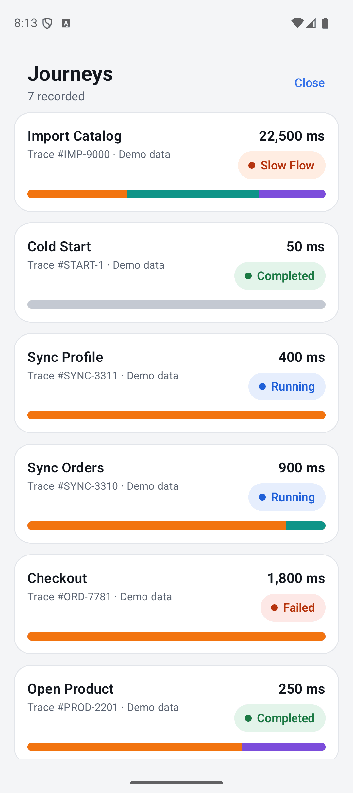
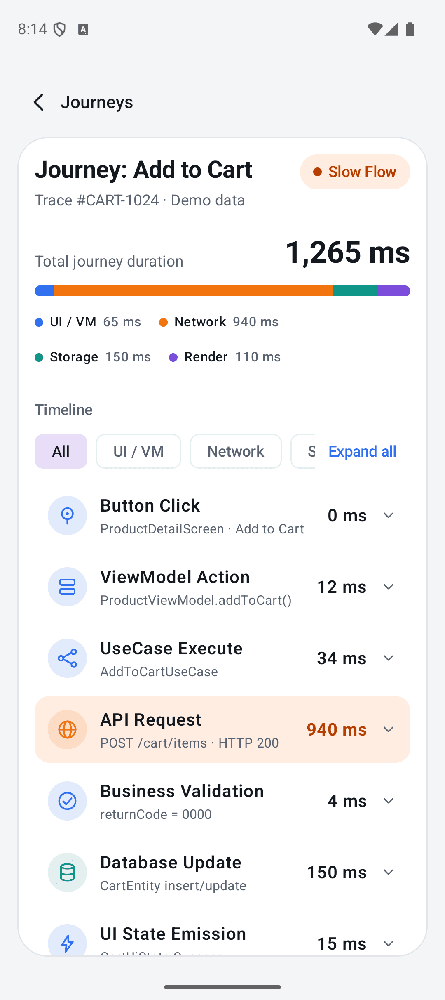
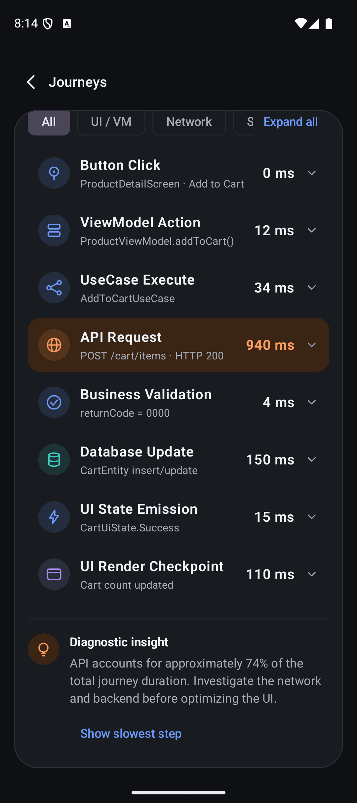

<h1 align="center">JourneyScope</h1>

<p align="center">
  Runtime debugging for Kotlin Multiplatform apps.<br>
  See the whole journey of an operation, not just its HTTP calls.
</p>

<p align="center">
  <a href="https://github.com/mandanai/devscope-compose/actions/workflows/ci.yml"></a>
  <a href="LICENSE"></a>
  
  
  
</p>

<p align="center">
  
  
  
</p>

JourneyScope records what happens between a tap and the resulting UI state: **UI → ViewModel → UseCase → Repository → Network → Database → UI state**. It shows the timeline in an in-app Compose inspector, explains slow or failing steps with evidence, and exports redacted reports you can safely share.

## Why JourneyScope

- **Whole journeys, not single requests.** Network, Flow, navigation and database activity are stitched into one trace through the coroutine context. No layer needs to pass a trace object around.
- **Private by default.** Keys, headers, URLs and failure messages are redacted at capture and again at export.
- **Zero cost in release.** Disabled until you opt in, with a `devscope-core-noop` twin for release builds.
- **One inspector for both platforms.** A Compose Multiplatform UI on Android and iOS.

## Features

- Tracing engine with coroutine-propagated journeys and spans
- Network tracing for Ktor (Android, iOS) and OkHttp (Android)
- `Flow`, `StateFlow` and `SharedFlow` tracing
- Navigation and lifecycle tracing
- SQLDelight query tracing
- Evidence-based diagnostics for slow, failing and repeated work
- Redacted export, import and on-device history

## Installation

JourneyScope is pre-release (`0.1.0-SNAPSHOT`) and is not on Maven Central yet. Publish it locally:

```bash
./gradlew publishToMavenLocal
```

Then add the modules you need:

```kotlin
repositories {
    mavenLocal()
    google()
    mavenCentral()
}

dependencies {
    implementation("dev.chayaphon.journeyscope:devscope-core:0.1.0-SNAPSHOT")
    debugImplementation("dev.chayaphon.journeyscope:devscope-android:0.1.0-SNAPSHOT") // Android: inspector via notification, no UI code
    debugImplementation("dev.chayaphon.journeyscope:devscope-ui-compose:0.1.0-SNAPSHOT") // iOS / embedding the Inspector yourself

    // Optional adapters
    implementation("dev.chayaphon.journeyscope:devscope-network-ktor:0.1.0-SNAPSHOT")
    implementation("dev.chayaphon.journeyscope:devscope-flow:0.1.0-SNAPSHOT")
}
```

Requires Android minSdk 26, JDK 17, and Xcode 26+ for iOS. See [publishing](docs/publishing.md) and [release safety](docs/release.md) for keeping debug tooling out of release builds.

## Usage

Configure once, debug builds only:

```kotlin
JourneyScope.configure(JourneyScopeConfig.debugOnly(isDebuggable = BuildConfig.DEBUG))
```

Wrap the operation you want to see:

```kotlin
JourneyScope.withJourney("Add to Cart") {
    traceSuspend("AddToCartUseCase", SpanCategory.USE_CASE) { repository.add(item) }
}
```

Add adapters where the work happens:

```kotlin
val client = HttpClient { install(JourneyScopeNetwork) }       // Ktor
val okHttp = OkHttpClient.Builder().addInterceptor(JourneyScopeInterceptor()).build()
```

Open the inspector: on Android with `devscope-android` tap the JourneyScope notification, nothing else to write. To embed it yourself:

```kotlin
JourneyScopeInspector(onClose = { showInspector = false })
```

The full walkthrough is in [Getting started](docs/getting-started.md).

## Modules

| Module | Purpose | Android | iOS |
|---|---|:-:|:-:|
| `devscope-core` | Tracing engine | ✅ | ✅ |
| `devscope-core-noop` | Release twin of the core facade | ✅ | ✅ |
| `devscope-ui-compose` | Compose Multiplatform Inspector | ✅ | ✅ |
| `devscope-network-ktor` | Ktor client plugin | ✅ | ✅ |
| `devscope-network-okhttp` | OkHttp interceptor | ✅ | — |
| `devscope-flow` | Flow, StateFlow and coroutine tracing | ✅ | ✅ |
| `devscope-navigation` | Navigation tracing | ✅ | ✅ |
| `devscope-database-sqldelight` | SQLDelight tracing | ✅ | ✅ |
| `devscope-diagnostics` | Evidence-based diagnostics | ✅ | ✅ |
| `devscope-export` | Redacted export, import, persistence | ✅ | ✅ |

iOS targets are `iosArm64` and `iosSimulatorArm64`.

## Sample app

An "Add to Cart" app exercises every module.

```bash
./gradlew :samples:androidApp:installDebug
```

For iOS, open `samples/iosApp/iosApp.xcodeproj` in Xcode 26+ and run. See [development](docs/development.md) and the [sample walkthrough](docs/sample-walkthrough.md).

## Documentation

**Guides**
[Getting started](docs/getting-started.md) ·
[Android](docs/android-integration.md) ·
[iOS](docs/ios-integration.md) ·
[Instrumentation](docs/instrumentation.md) ·
[Diagnostics](docs/diagnostics.md) ·
[Export](docs/export.md)

**Reference**
[Architecture](docs/architecture.md) ·
[Modules](docs/modules.md) ·
[API](docs/api.md) ·
[Performance](docs/performance.md) ·
[Privacy and security](docs/privacy-security.md)

**Project**
[Publishing](docs/publishing.md) ·
[Release safety](docs/release.md) ·
[Release readiness](docs/release-readiness.md) ·
[Changelog](docs/CHANGELOG.md)

## Contributing

Contributions are welcome. Read [CONTRIBUTING.md](docs/CONTRIBUTING.md) first, and see [privacy and security](docs/privacy-security.md) before reporting a vulnerability.

## License

Licensed under the Apache License, Version 2.0. See [LICENSE](LICENSE) for the full text.
