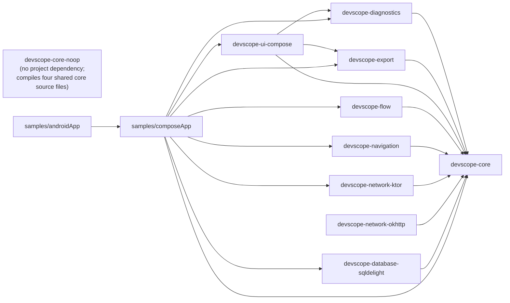

# Architecture

## Dependency direction

- `devscope-core` depends on nothing but Kotlin stdlib and kotlinx-coroutines. No Compose, Android or UIKit.
- Adapters depend only on core, never on each other or on the UI. `devscope-ui-compose` depends on core, diagnostics and export.
- The graph is acyclic (Gradle rejects project cycles) and no `commonMain` imports `android.*`.
- Third-party types appear in an adapter's public API only where they are the point (`ktor-client-core`, `okhttp`, `sqldelight-runtime`, lifecycle on Android).
## Source sets
`commonMain`/`commonTest` by default; `androidMain`/`iosMain` only where a platform API forces it. Targets: `android`, `iosArm64`, `iosSimulatorArm64`.

## Build
- Convention plugins in `build-logic/convention` (`journeyscope.kmp.library`, `journeyscope.compose`, `journeyscope.publishing`, `journeyscope.sample.*`).
- Versions only in `gradle/libs.versions.toml`.
- SDK modules use `explicitApi()`, Kotlin ABI validation baselines (`api/`), treat warnings as errors, and compile at Kotlin language/API 2.1 (`kotlinLanguage` in the catalog).
- AGP 9 forbids combining the KMP plugin with `com.android.application`, so the Android sample is split: `samples/composeApp` (KMP library) and `samples/androidApp` (application).

## Principles
Offline-first, no mandatory backend, no DI framework required, disabled by default (`JourneyScope.isEnabled`, turned on via `JourneyScope.configure`), secure-by-default data collection (key/header/URL redaction at capture, a second redaction pass at export).

## Runtime tracing engine (`devscope-core`)
See [api.md](api.md) for usage. Layers: `JourneyScope` (facade) -> `JourneyTracer` (engine) -> `Journey`/`SpanHandle` (live handles) -> `JourneyRecorder` (bounded storage + `SharedFlow` events). Immutable snapshots: `JourneyTrace`, `JourneySpan`, `JourneyEvent`.

### Concurrency model
- Each `Journey` owns a `MutableStateFlow<TraceState>` and mutates it with a pure compare-and-set loop; journeys never contend with each other. State holders are plain classes so CAS uses identity, not deep `equals`.
- IDs, clock reads, `FailureInfo` and recorder notifications happen outside the CAS reducer, which may re-run.
- The recorder only tracks trace membership (copy-on-write ring) and emits change events with `tryEmit` into a `DROP_OLDEST` `SharedFlow`; writers never suspend or block. Slow collectors should re-read `snapshot()`.
- Ordering is `(monotonic time, per-trace sequence)`, so equal timestamps stay deterministic.

### Context propagation
`TraceContext(journey, spanId)` is a coroutine context element. `traceSuspend` takes its parent from the context (only if it belongs to the same journey) and installs a new element for the block, so concurrent children keep their own parents and journeys stay isolated. There is no global "current span". Use `Journey.context(parent)` / `launchInJourney` for work launched outside the propagating scope, and `beginSpan` handles for callbacks.

### Timing model
- Durations use a monotonic clock; wall-clock values are stored only for display/export.
- Inclusive = end - start. Exclusive = inclusive minus the *union* of child intervals, so overlapping children are never double counted.
- Journey duration = journey end - start, never a sum of spans. Gaps are time inside the journey not covered by any root span.
- Event timestamps are positions on the timeline (`offsetFromStart`); no API turns two events into an operation duration.
- Critical path walks backward from the end taking the latest-finishing span that ends before the cursor (an approximation: no explicit dependency edges).
- Spans still open when a journey ends are closed `INTERRUPTED` (or `CANCELLED`) with `endedBySystem = true`; they are never reported as OK.

### Limitations
- Copy-on-write lists make each write O(items), bounded by `maxEventsPerTrace`.
- Synchronous `trace {}` cannot read a coroutine context; nest through the passed `SpanHandle` or `parent`.
- A span failure does not fail its journey (the app may handle the exception); call `fail` or use `withJourney`.
- `withContext` checks cancellation on return, so a block that finished just as its job was cancelled is recorded as CANCELLED.
- Evicted running journeys stop recording; late writes after a terminal state are dropped and counted in `droppedItems`.
- Persistence lives in `devscope-export` and is opt-in; core only offers the `spi` interfaces. Lifecycle observers are still the host's job (call `JourneyScope.interruptActive` when the app is backgrounded).
- `maxEventsPerSecond` (default off) drops events above a per-trace rate within a one-second window and counts them in `droppedItems`.
