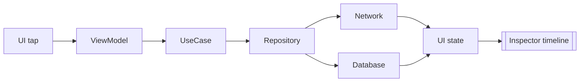
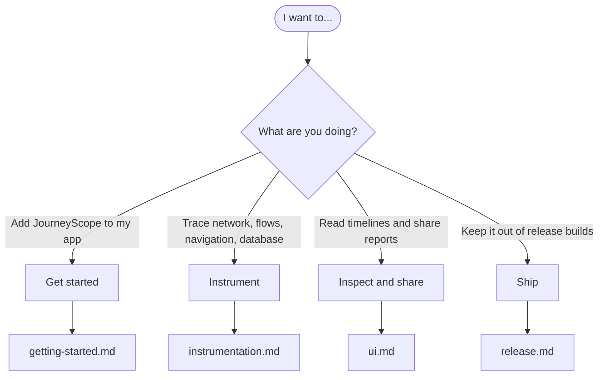

# JourneyScope

Runtime debugging for Kotlin Multiplatform apps. See the whole journey of an operation, not just its HTTP calls.

JourneyScope records what happens between a tap and the resulting UI state, shows the timeline in an in-app Compose inspector, explains slow or failing steps with evidence, and exports redacted reports you can safely share.

{ width="220" }
{ width="220" }
{ width="220" }

## Pick your path

- **[Get started](getting-started.md)**: install, configure and open the Inspector in six steps.
- **[Instrument](instrumentation.md)**: Ktor, OkHttp, Flow, navigation and SQLDelight adapters.
- **[Inspect and share](ui.md)**: read a timeline, run diagnostics, export a redacted report.
- **[Ship](release.md)**: noop twins and disabled mode for release builds.

## Why JourneyScope

- **Whole journeys, not single requests.** Network, Flow, navigation and database activity are stitched into one trace through the coroutine context.
- **Private by default.** Keys, headers, URLs and failure messages are redacted at capture and again at export.
- **Zero cost in release.** Disabled until you opt in, with a `-noop` twin for release builds.
- **One inspector for both platforms.** Compose Multiplatform UI on Android and iOS.
